<div align="center">
  
</div>

<p align="center">
  <a href="https://www.linkedin.com/in/raquel-oliveiras/">LinkedIn</a>
  &nbsp;|&nbsp;
  Rio de Janeiro, Brasil
  &nbsp;|&nbsp;
  Inglês intermediário
</p>

## $ sobre

Estudante de Engenharia de Software e estagiária de Cibersegurança na área de Red Team. Estou construindo minha base em segurança ofensiva e em segurança de ambientes AWS. Uso este perfil para registrar o que estudo, o que pratiquei em laboratórios e o que pretendo desenvolver.

> **Transparência:** ainda não tenho projetos próprios publicados em Red Team. Os laboratórios AWS listados abaixo foram realizados em atividades de formação e ambientes educacionais (laboratórios guiados), e não são projetos autorais.


## $ estudando

| Frente | Situação | O que estou estudando |
|---|---|---|
| **Cibersegurança** | Em estudo | Fundamentos de segurança da informação, redes, tipos de ataque e defesa, governança e riscos, DevSecOps e nuvem, pelo Cyber Academy da FEBRABAN. Notas pessoais em [FEBRABAN-Cyber-Academy-2026](https://github.com/heyraqueell/FEBRABAN-Cyber-Academy-2026). |
| **Red Team e segurança ofensiva** | Iniciando | Atuação como estagiária na área e estudo dos conceitos de pentest e Red Team. Projetos próprios: ainda não publicados. |
| **AWS e Cloud Computing** | Em estudo | Formação técnica na Escola da Nuvem e preparação para o AWS Certified Cloud Practitioner (prova ainda não realizada). Notas pessoais em [AWS-Cloud-Practitioner](https://github.com/heyraqueell/AWS-Cloud-Practitioner). |
| **Programação** | Em desenvolvimento | Java e programação orientada a objetos. Notas e exercícios em [Evolution-Java](https://github.com/heyraqueell/Evolution-Java). |

**Cursos concluídos**

- Foundations of Cybersecurity (Google). É o primeiro curso do Certificado de Cibersegurança do Google; o certificado completo não foi concluído.
- Google AI Essentials (Google).

**Participação em eventos:** AWS General Immersion Day e GloboSec Week 2026.


## $ stack

| Nível | Tecnologias |
|---|---|
| **Contato prático** | `Linux` (uso no dia a dia) &nbsp;·&nbsp; `Git` &nbsp;·&nbsp; `GitHub` |
| **Estudando** | `AWS`: EC2, S3, VPC, IAM, RDS, Auto Scaling, EBS, API Gateway e Lambda (em laboratórios guiados) |
| **Em desenvolvimento** | `Java` (iniciante, com foco em POO) &nbsp;·&nbsp; `SQL / MySQL` &nbsp;·&nbsp; `HTML / CSS` |


## $ labs

### Laboratórios AWS (guiados)

Práticas realizadas em atividades de formação. A documentação detalhada de cada um (objetivo, serviços, procedimento, validação e aprendizados) está sendo organizada no repositório [AWS-Hands-On-Labs](https://github.com/heyraqueell/AWS-Hands-On-Labs).

| Serviço | O que foi praticado |
|---|---|
| **EC2** | Criação e configuração de instâncias |
| **S3** | Criação de buckets e hospedagem de site estático |
| **VPC** | Rede, sub-redes, tabelas de rotas, Security Groups e Network ACLs, além de troubleshooting de conectividade |
| **IAM** | Usuários, grupos e políticas de permissões |
| **RDS + EC2** | Configuração de banco de dados e conexão com instâncias EC2 |
| **Auto Scaling** | Grupos de Auto Scaling e modelos de execução (launch templates) |
| **EBS** | Volumes, montagem e snapshots |
| **API Gateway + Lambda** | Integração entre serviços |

### Segurança ofensiva e Cloud Security

Ainda não há projetos publicados nesta área. O que pretendo registrar aqui, conforme eu avançar (**planejado, ainda não realizado**):

- Write-ups de laboratórios de segurança em plataformas de treinamento autorizadas, com foco na metodologia.
- Laboratórios de segurança na AWS, em conta própria de testes, com documentação do ambiente, dos achados e das correções.


## $ objetivos

- Aprofundar meus conhecimentos em segurança ofensiva e Red Team, sempre em ambientes autorizados.
- Entender a AWS pela ótica da segurança: identidades e permissões, redes e configuração segura.
- Conquistar o AWS Certified Cloud Practitioner e seguir para estudos mais avançados em nuvem.
- Evoluir em Linux e redes de computadores.
- Transformar meus estudos e laboratórios em material documentado e verificável neste perfil.


## $ contato

- LinkedIn: [linkedin.com/in/raquel-oliveiras](https://www.linkedin.com/in/raquel-oliveiras/)

```text
$ echo "em evolução constante"
em evolução constante
```
